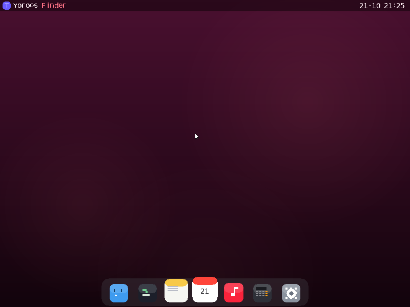
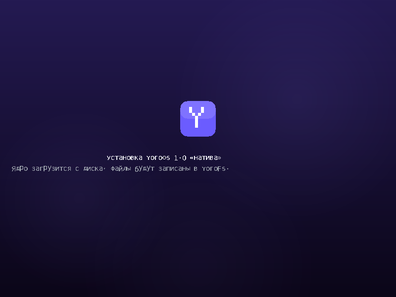
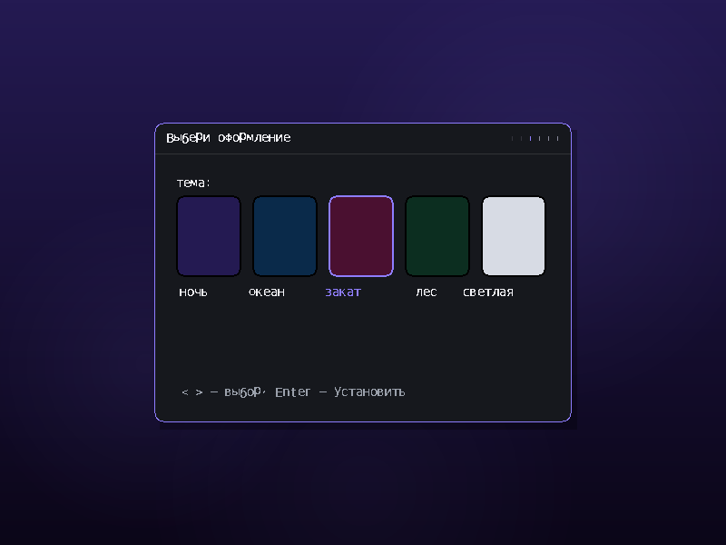
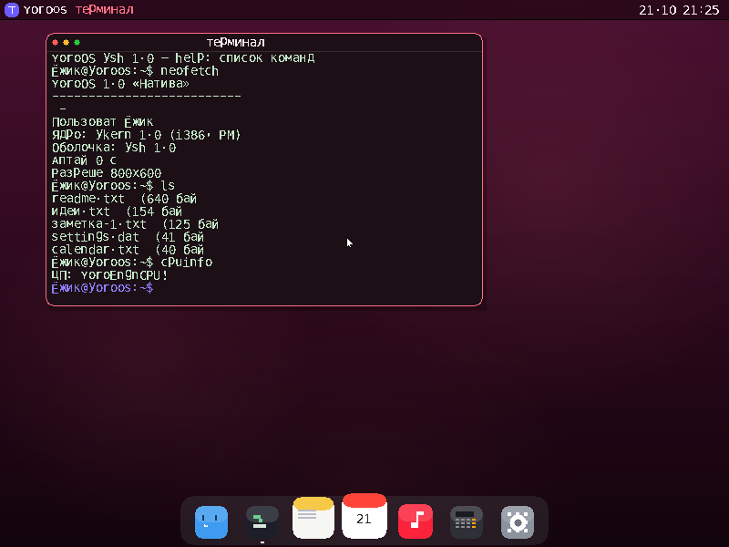
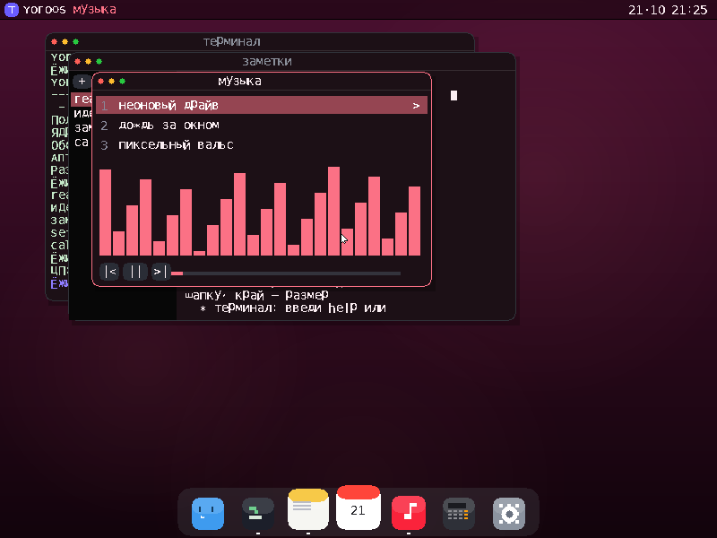
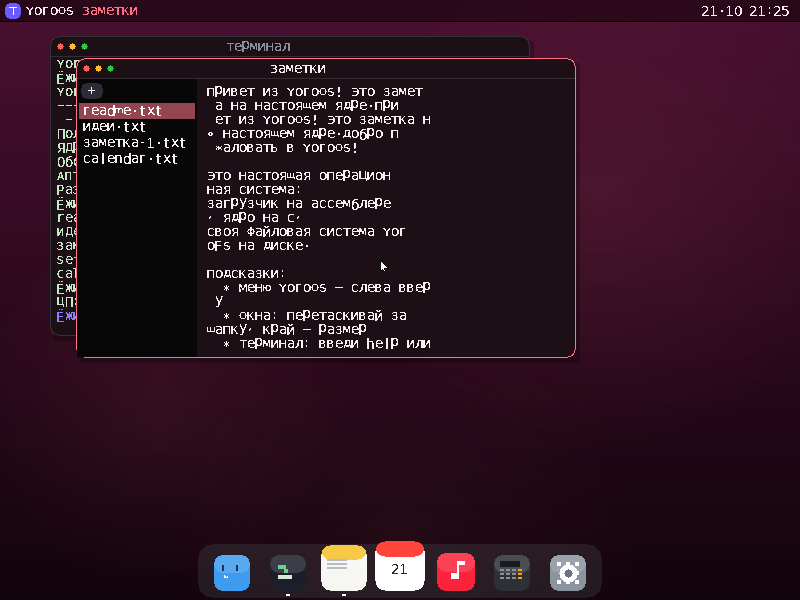
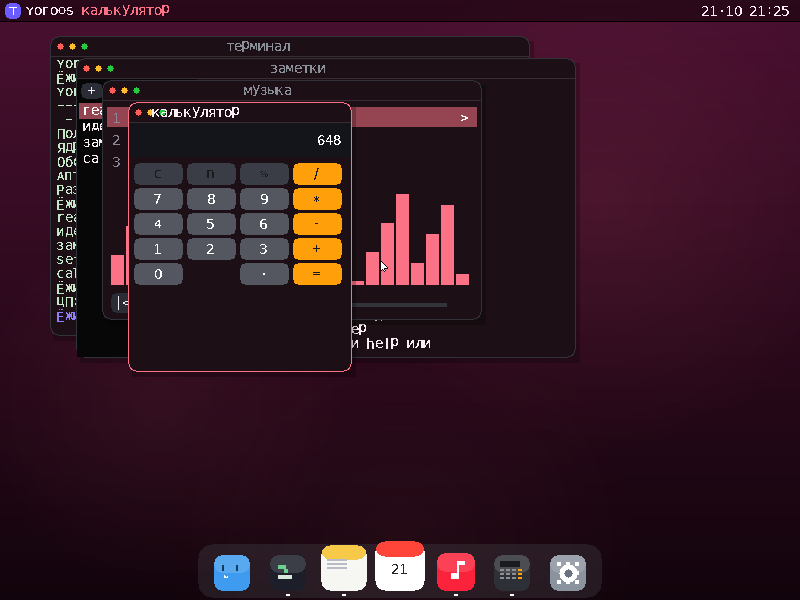

# YoroOS 1.0 «Натива»

**Настоящая операционная система с нуля: загрузчик на ассемблере, ядро на C, своя файловая система.** Никакого браузера, никакого Linux внутри — голое железо (x86), 32-битный защищённый режим, VBE-графика 800×600×32bit.



## Возможности

| Подсистема | Что умеет |
|---|---|
| **Загрузка** | BIOS → свой загрузочный сектор (LBA) → второй загрузчик → VBE 800×600×32 → A20 → GDT → защищённый режим → ядро |
| **Ядро** | IDT (48 векторов), PIC, PIT 100 Гц, PS/2 клавиатура (RU/EN по Alt), PS/2 мышь, RTC, PC-динамик |
| **YoroFS** | своя ФС на ATA PIO (LBA28): 128 файлов, настройки системы, всё переживает перезагрузку |
| **GUI «Aqua-Y»** | меню-бар с часами, док с магнификацией, окна: перетаскивание, ресайз, светофор (закрыть/свернуть/на весь экран), фокус, тени |
| **Приложения** | Finder, Терминал (ysh), Заметки, Календарь, Музыка (синтез через PC-динамик!), Калькулятор, Настройки (5 тем), Просмотр |
| **Установщик** | мастер первого запуска: приветствие → лицензия → имя пользователя → тема → прогресс → готово (как в «больших» ОС) |

## Скриншоты

| Установщик | Выбор темы |
|---|---|
|  |  |

| Терминал (`neofetch`, `ls`) | Музыка с визуализатором |
|---|---|
|  |  |

| Заметки | Калькулятор |
|---|---|
|  |  |

## Сборка

Нужны: `gcc` (с `-m32`), `python3`, `nasm` не нужен (GCC as), QEMU для запуска.

```bash
make            # соберёт yoroos.img (16 МБ, boot+loader+kernel)
make sim        # соберёт хост-симулятор (для разработки без QEMU)
make run-sim    # прогнать сценарий симуляции
```

## Запуск

### QEMU
```bash
qemu-system-i386 -hda yoroos.img -m 128
# со звуком:
qemu-system-i386 -hda yoroos.img -m 128 -audiodev pa,id=snd -machine pcspk-audiodev=snd
```

### Реальное железо
```bash
sudo dd if=yoroos.img of=/dev/sdX bs=1M status=progress
```
Грузится с USB/диска на любом BIOS-совместимом x86 ПК. **Диск 16 МБ — данные пишутся в образ (YoroFS).**

## Управление

- **Мышь** — повсюду: окна, светофор, док, меню YoroOS (слева вверху)
- **Alt** — переключение RU/EN раскладки
- **Enter** — подтверждение в установщике
- **Терминал**: `help`, `ls`, `cat`, `echo`, `touch`, `rm`, `uptime`, `date`, `cpuinfo`, `df`, `neofetch`, `open`, `apps`, `reboot`, `shutdown`, `clear`

## Структура проекта

```
boot/boot.S        загрузочный сектор (512 байт, читает лоадер через int 13h AH=42h)
boot/loader.S      второй загрузчик: VBE, загрузка ядра, A20, GDT, вход в PM
kernel/entry.S     вход ядра: стек, очистка BSS, вызов kmain
kernel/isr.S       48 обработчиков прерываний (сгенерирован)
kernel/font.c      растровый шрифт 8×14, 189 глифов с кириллицей (из DejaVu, генерируется)
kernel/src/hw.c    IDT, PIC, PIT, PS/2, RTC, спикер
kernel/src/ata.c   ATA PIO драйвер (LBA28)
kernel/src/fs.c    YoroFS + settings.dat
kernel/src/gfx.c   двойная буферизация, обои, blend, текст, скругления
kernel/src/ui.c    меню-бар, док, оконный менеджер, курсор
kernel/src/apps.c  все приложения
kernel/src/installer.c  мастер установки
tools/flatlink.py  плоский линкер ELF32 → плоский бинарник (свой!)
tools/genfont.py   генератор шрифта из DejaVu
tools/sim.c        хост-симулятор: рендерит кадры системы в PNG (out/*.ppm)
```

## Как это сделано без стандартных инструментов

- **Свой линкер** (`tools/flatlink.py`): обычный `ld -m elf_i386` отсутствовал в среде сборки, поэтому написан линкер ELF32-объектников: секции фазами (код → данные → BSS), релокации R_386_32/PC32/16 и др., COMMON-символы в BSS, контроль неразрешённых символов.
- **Симулятор вместо QEMU**: в среде нет QEMU, поэтому ядро (тот же C-код, что и на железе) компилируется для хоста с заглушками портов ввода-вывода и рендерит реальные кадры ОС в PNG — так найдены и исправлены десятки багов (переполнения буферов ловил AddressSanitizer).

## Тесты

```bash
./build/sim install   # установка: 6 экранов мастера + рабочий стол
./build/sim apps      # терминал (neofetch/ls/cpuinfo), заметки, музыка, калькулятор, календарь, finder, настройки, меню
./build/sim mouse     # drag окна, максимизация светофором, клик по доку
```
Кадры кладутся в `out/*.ppm`. Симулятор сохраняет диск в `/tmp/yoro_disk.bin` — файлы переживают «перезагрузку».

---
YoroOS — учебно-боевая ОС: ASM (загрузка) + C (ядро), 0 зависимостей, весь код в этом репозитории.
